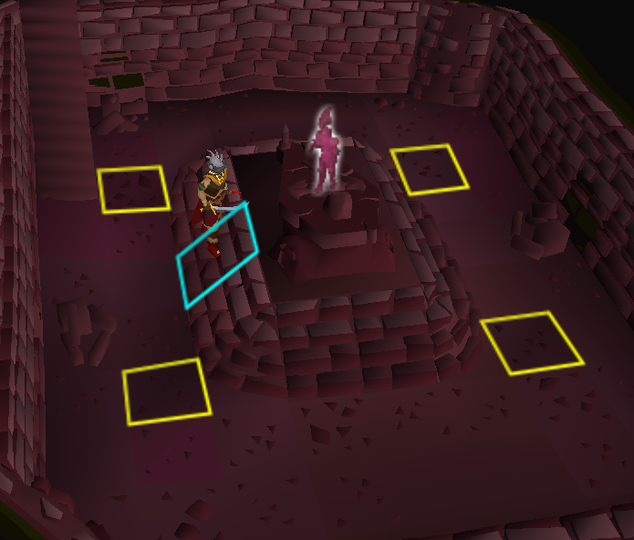
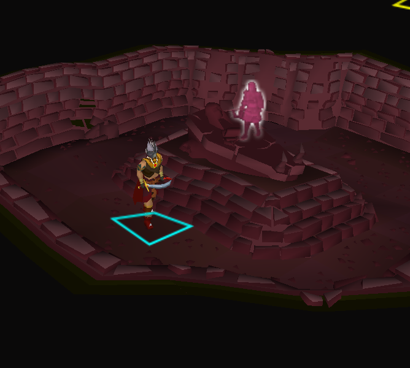
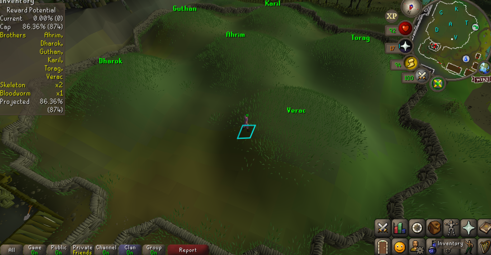
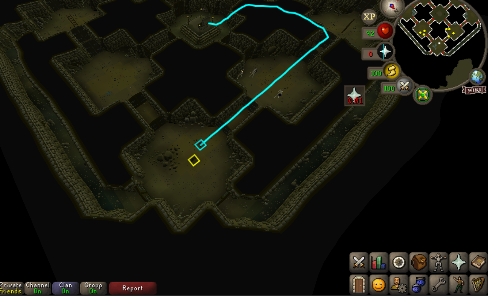

# EzBarrows

A RuneLite plugin that makes Barrows runs easier:

- Shows a portrait of the brother above his sarcophagus
- Labels each mound with its brother's name, coloured by whether he's alive, killed or hiding the tunnel
- Tracks your reward potential and tells you what to kill to get as close to your cap as possible
- Outlines the tunnel monsters you still need, and the chest once you're done
- Draws the shortest route through the tunnels to the chest

## Features

### Brother portraits on sarcophagi

When you're in a crypt, a portrait of that crypt's brother appears above his sarcophagus, so you know who you're about to fight. Working out which protection prayer to use is still up to you.

Only the sarcophagus in the crypt you're standing in is shown, and the portrait disappears once you've killed that brother.

  
  

### Brother names on the mounds

On the surface, each mound is labelled with its brother's name:

- **Green**: still alive
- **Red**: killed this run
- **Blue**: hiding the tunnel, as soon as the hidden tunnel prompt appears in his crypt (even if you don't go in yet), or once the other five are dead

The tunnel brother is remembered until you loot the chest.

### Reward potential tracker

While you're at Barrows, a panel (top left in the screenshot above) shows your current reward potential and your cap, both as a percentage and in points (out of 1012). It lists the tunnel monsters that get you as close to the cap as possible without going over, assuming you kill every brother still alive, along with where that leaves you. Going over the cap is treated as worse than falling short. It updates after every kill, so if you kill something by accident it works out the best way to finish under the cap.

The default cap is 874 points: 6 brothers, 2 skeletons and 1 bloodworm. 880 points (86.95%) is the highest useful cap, as it maximises runes while ruling out bolt racks, half keys and dragon med helms.

### Target monsters and chest

In the tunnels, any monster the reward potential panel suggests is outlined in blue, so a bloodworm you still need stands out. Once you've killed enough of that monster, the outline goes.

When every brother is dead and no more kills would get you closer to your cap, the chest is outlined in green to show it's time to loot.

### Tunnel path

In the tunnels, a line on the ground shows the shortest route from where you're standing to the chest. Door locks change every run, so the route only goes through doors you can open. The line only appears in the tunnels, not in the brothers' crypts.

## Settings

| Setting | Default | Description |
| --- | --- | --- |
| Hide Killed Brothers | On | Hide the portrait once that brother has been killed this run |
| Show Brother Names | On | Label each mound with its brother's name and status |
| Show Tunnel Path | On | Draw the route to the chest in the tunnels |
| Tunnel Path Colour | Cyan | Colour of the route line |
| Show Reward Potential | On | Show the reward potential panel |
| Points Cap | 874 | Reward points to get closest to without going over, out of 1012 |
| Highlight Target Monsters | On | Outline tunnel monsters you still need to kill to get closest to your cap |
| Target Monster Colour | Blue | Colour of the outline on target monsters |
| Highlight Chest When Ready | On | Outline the chest once every brother is dead and no more kills would get you closer to your cap |
| Ready Chest Colour | Green | Colour of the outline on the chest when it's ready to loot |
