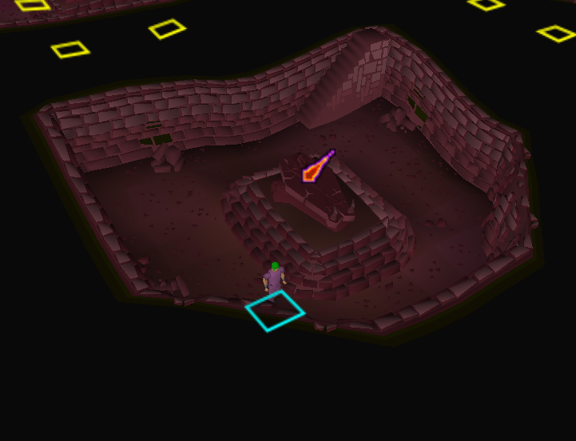

# EzBarrows

A RuneLite plugin that makes Barrows runs easier:

- Shows which protection prayer to use above each brother's sarcophagus
- Labels each mound with its brother's name, coloured by whether he's alive, killed or hiding the tunnel
- Tracks your reward potential and tells you what to kill to get as close to your cap as possible
- Draws the shortest route through the tunnels to the chest

## Features

### Prayer icons on sarcophagi

When you're in a crypt, the brother's sarcophagus shows the protection prayer you need:

| Brother | Prayer |
| --- | --- |
| Ahrim | Protect from Magic |
| Karil | Protect from Missiles |
| Dharok, Guthan, Torag, Verac | Protect from Melee |

Only the sarcophagus in the crypt you're standing in is shown, and the icon disappears once you've killed that brother.

### Brother names on the mounds

On the surface, each mound is labelled with its brother's name:

- **Green**: still alive
- **Red**: killed this run
- **Blue**: hiding the tunnel, once you've found it (or once the other five are dead)

The tunnel brother is remembered until you loot the chest.

### Reward potential tracker

While you're at Barrows, a panel (top left in the screenshot above) shows your current reward potential and your cap, both as a percentage and in points (out of 1012). It lists the brothers you still need to kill and the tunnel monsters that get you as close to the cap as possible without going over, along with where that leaves you. Going over the cap is treated as worse than falling short. It updates after every kill, so if you kill something by accident it works out the best way to finish under the cap.

The default cap is 874 points: 6 brothers, 2 skeletons and 1 bloodworm. 880 points (86.95%) is the highest useful cap, as it maximises runes while ruling out bolt racks, half keys and dragon med helms.

### Tunnel path

In the tunnels, a line on the ground shows the shortest route from where you're standing to the chest. Door locks change every run, so the route only goes through doors you can open.

## Settings

| Setting | Default | Description |
| --- | --- | --- |
| Hide Killed Brothers | On | Hide the icon once that brother has been killed this run |
| Show Brother Names | On | Label each mound with its brother's name and status |
| Show Tunnel Path | On | Draw the route to the chest in the tunnels |
| Tunnel Path Colour | Cyan | Colour of the route line |
| Show Reward Potential | On | Show the reward potential panel |
| Points Cap | 874 | Reward points to get closest to without going over, out of 1012 |
